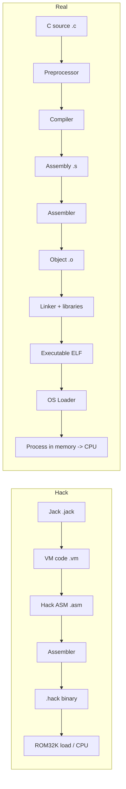

# Q5 – Hack toolchain vs a real toolchain

| Stage | Hack (Nand2Tetris) | Real toolchain (e.g. gcc on Linux) |
|---|---|---|
| Source | `.asm` (hand-written, or VM → asm) | `.c` |
| Compiler | Jack compiler → VM → VM translator → `.asm` | `cc1`: C → assembly (`.s`) after preprocessing |
| Assembler | `Assembler`: symbols/labels → addresses, mnemonics → 16-bit words (`.hack`) | `as`: `.s` → relocatable object `.o` (machine code + symbol table + relocation entries) |
| Linker | none: one program, absolute addresses fixed by the assembler (variables from RAM[16]) | `ld`: merges `.o` files and libraries, resolves external symbols, assigns final addresses, produces executable (ELF) |
| Loader | none: ROM32K is loaded directly (`ROM32K load X.hack`), PC starts at 0 | OS loader (`execve`): maps segments into virtual memory, sets up stack/heap, dynamic linking (`ld.so`), jumps to entry point |
| Memory protection | none; I/O is plain memory | MMU, privilege levels, ASLR, NX |
| Instruction set | 2 formats, 16-bit | hundreds of variable-length instructions |

Role summary
- **Assembler:** translation of one source file, text → bits, resolves *local* labels.
- **Linker:** combines many objects, resolves *cross-file* symbols and relocations.
- **Loader:** puts the finished binary in memory at run time and starts it.

## Flow diagram (Mermaid – paste into mermaid.live or GitHub renders it)

`toolchain_diagram.png` is the same diagram as an image (generated by `make_diagram.py`).

## Security link
Each stage is a trust boundary: a malicious or buggy compiler/linker can alter output, the loader decides
what is executable (NX/ASLR), and none of that exists in Hack — any program can write any RAM/I/O address.
